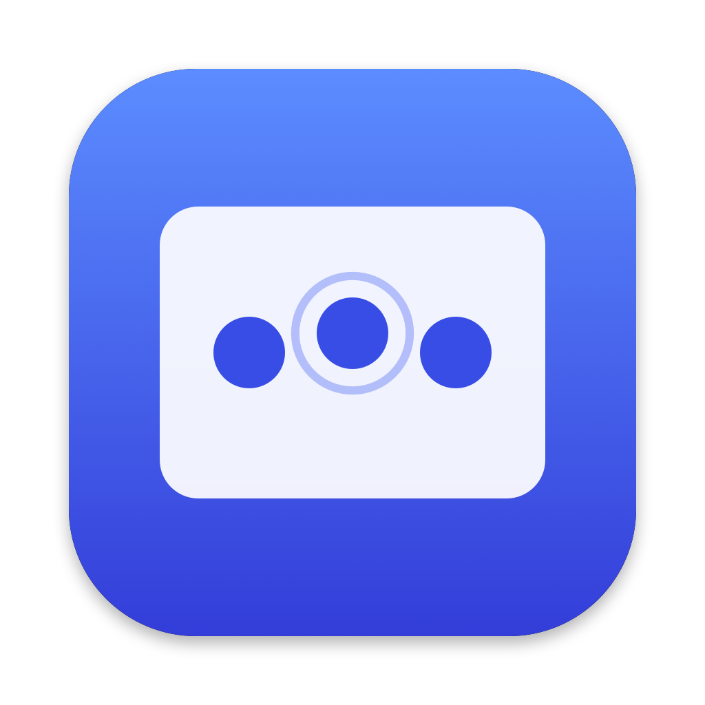

<p align="center">
  
</p>

<h1 align="center">Midpoint</h1>

<p align="center">Middle click on your Mac trackpad: a three-finger click or a three-finger tap.</p>

---

Midpoint is a small, free, open-source menu bar app for macOS. With it you can open links in background
tabs, close browser tabs, paste in Terminal, or pan in CAD apps without a mouse.

- **Three-finger click:** press the trackpad with three fingers and get a middle click. Holding and dragging gives a middle-button drag.
- **Three-finger tap:** a light three-finger tap also sends a middle click.
- **Menu bar status:** the icon dims when Midpoint isn't active, and a live status window shows the finger count and the last click.
- **Lightweight:** about 500 lines of Swift, no dependencies, no network access, no analytics.

## Requirements

- macOS 14 Sonoma or later (Apple silicon or Intel)
- Built-in or Magic Trackpad
- Xcode or the Command Line Tools (`xcode-select --install`) to build

## Install (build from source)

```sh
git clone https://github.com/akhilmadipalli/midpoint.git
cd midpoint
./build.sh --install          # builds and copies Midpoint.app to /Applications
open /Applications/Midpoint.app
```

On first launch macOS asks for **Accessibility** access, which Midpoint needs to send middle clicks.
Turn Midpoint on in **System Settings → Privacy & Security → Accessibility**. It starts working
within a second; no relaunch needed.

> **Signing note:** `build.sh` signs with your Apple Development / Developer ID certificate if you have one
> (or set `MIDPOINT_SIGN_IDENTITY`). Without a certificate it signs ad-hoc, and macOS forgets the
> Accessibility permission each time you rebuild: remove Midpoint from the Accessibility list and add it again.

## Usage

Click the menu bar icon to switch gestures on or off, enable **Launch on Login**, or open **Settings…**.
If you hide the menu bar icon, open Midpoint from Finder or Spotlight to get the settings window back.

### Conflicts with macOS gestures

macOS has its own uses for three fingers. Turn these off in **System Settings → Trackpad**:

- **Look up & data detectors → Tap with three fingers.** This competes with three-finger tap.
- **Accessibility → Pointer Control → Trackpad Options → Use trackpad for dragging → Three Finger Drag.**
  When this is on, macOS treats a three-finger tap as a click.

## How it works

1. **Touch input.** Midpoint reads raw contact frames from Apple's private `MultitouchSupport` framework,
   so it always knows how many fingers are on the trackpad.
2. **Three-finger click.** A session-level `CGEventTap` intercepts left-mouse events. If three fingers are down
   when the trackpad is pressed, the event is rewritten in place to the middle button (`otherMouseDown/Dragged/Up`,
   button 2) before any app sees it.
3. **Three-finger tap.** When all fingers lift, Midpoint checks the touch session: exactly three fingers,
   shorter than 0.35 s, almost no movement, and no physical click. If all hold, it posts a middle click
   at the cursor.

Everything is in [`Sources/main.swift`](Sources/main.swift) (engine) and [`Sources/UI.swift`](Sources/UI.swift)
(menu bar item and settings window).

> `MultitouchSupport` is a private Apple framework. It has been stable for years, but a future macOS update
> could break Midpoint.

## Troubleshooting

- **Nothing happens:** open **Settings…** from the menu bar.
  - If **Fingers on trackpad** stays at 0 while you touch the trackpad, touch input isn't arriving.
  - If the finger count works but **Last middle click** never changes, check the gesture conflicts above.
- **Debug log:** Settings → **Open Debug Log** (`~/Library/Logs/Midpoint.log`). Each touch session is logged
  with finger count, duration, movement, and whether it counted as a tap.
- **Raw touch probe:** `swiftc -O -o build/mtprobe tools/mtprobe.swift && build/mtprobe 15` prints raw
  multitouch frames for 15 seconds.

## Uninstall

Quit Midpoint from the menu bar, delete `/Applications/Midpoint.app`, and remove it from
Privacy & Security → Accessibility.

## License

[MIT](LICENSE)
